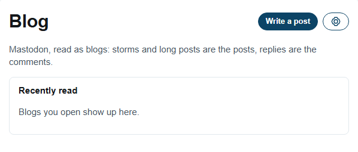

# Blog

Blog turns long Mastodon posts and threads by a single author into articles. Replies appear as comments. Choose **Apps → Blog** to open your **Desk**.

{ .help-screenshot }

- **Desk** shows recent posts, drafts and blogs you’ve opened. If a draft seems to be missing, choose **All** in the drafts list to include short drafts.
- **Search** lets you look up a Mastodon author by handle to read their blog.
- **Mine** opens your own blog when you’re signed in. Open an article to read it with its comments.

Ready to publish? [Write your first blog post](write.md).
