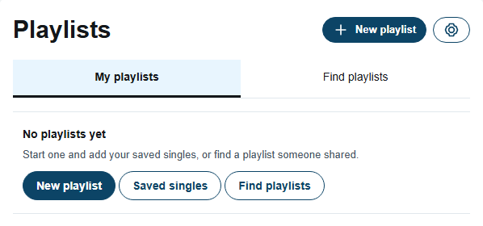

# Make a Radio playlist

Start in **Radio → Playlists** when you want a set of recordings to play one after another.

{ .help-screenshot }

1. Choose **New playlist** and give it a name you’ll recognize.
2. Open the playlist. Add a recording from your saved singles, or choose **Find more singles** to search for one.
3. Choose **Add to playlist** beside a search result, then open the playlist to see the track list.
4. Return to **Playlists** and use the play button next to its name.

If a single plays on its own page, you can still keep it under **Saved singles**. For continuous playback, look for recordings attached directly to Mastodon posts.
