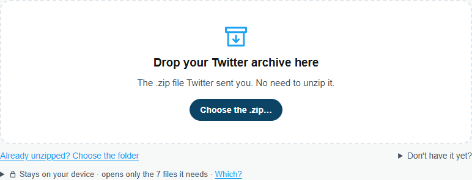

# Twitter to Mastodon (Unbird)

Use **Apps → Unbird** to find people you followed on Twitter who now have Mastodon accounts. You can start with your Twitter archive before choosing a Mastodon server.

{ .help-screenshot }

1. In X settings, open **Your account → Download an archive of your data** and request your archive.
2. When it arrives, open [Twitter to Mastodon](https://mawkingbird.com/twitter-to-mastodon/) and drop the ZIP file on **Drop your Twitter archive here**. You can also choose the extracted folder. If your archive came in parts, select them together.
3. Review the account and item counts to check you opened the right archive. The archive is read on your device. Looking for accounts sends searches to Mastodon.
4. [Review your matches](people.md) before following anyone.
